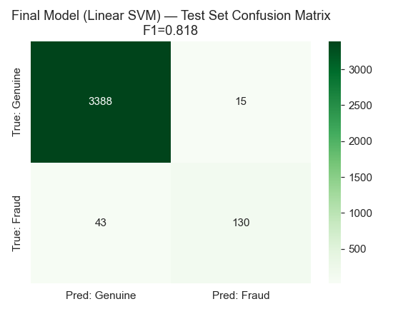
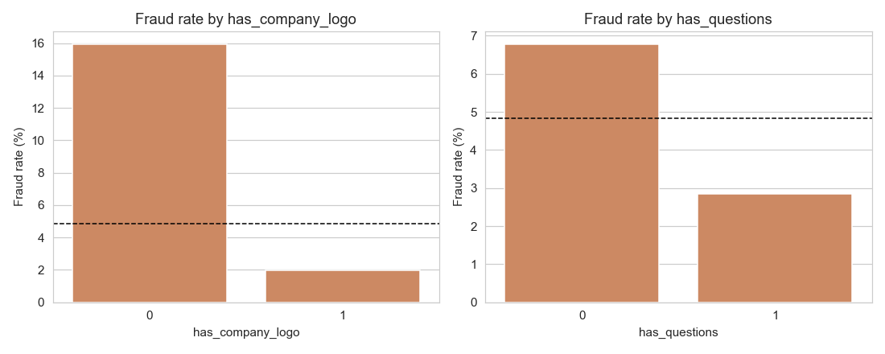
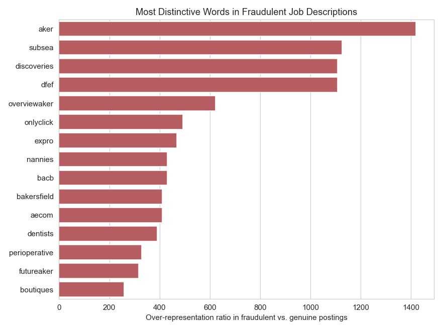
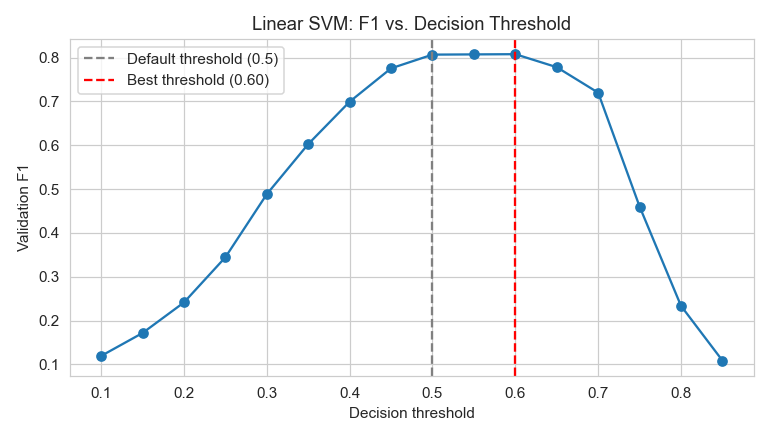
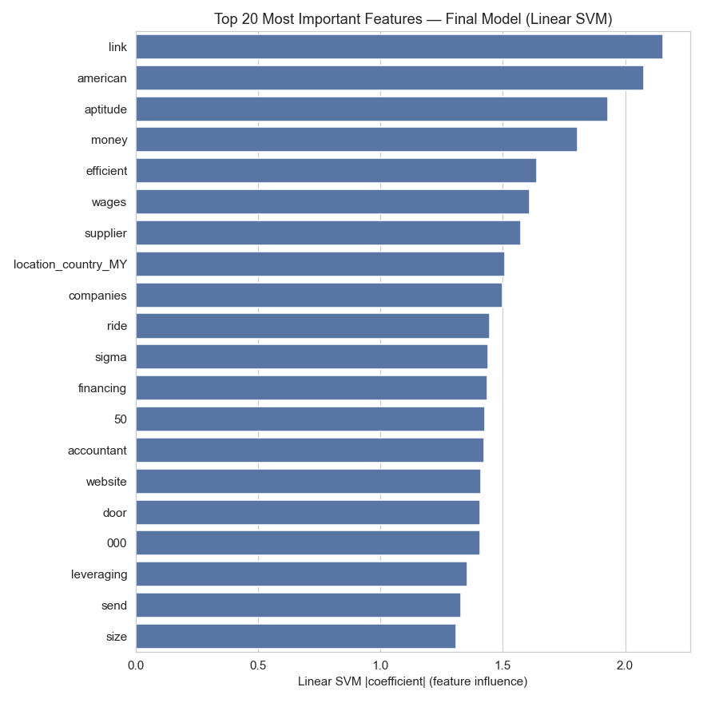

# Fraudulent Job Posting Detection

A machine learning pipeline that classifies online job postings as **genuine or fraudulent** from their text and metadata. It uses the EMSCAD dataset of 17,880 real job ads, of which only 4.84% are scams.



## Results
Final model: **Linear SVM** with a tuned decision threshold (0.60), evaluated on a held-out test set:

| Metric | Score |
|---|---|
| **F1 (fraud class)** | **0.82** |
| Precision | 0.90 |
| Recall | 0.75 |
| Accuracy | 98.4% |

Of every 10 postings the model flags, about 9 really are scams, and it catches about 3 in every 4 scams. Test F1 (0.818) closely matched validation F1 (0.808), and 2-fold cross-validation was stable (F1 0.777 ± 0.003), so the model generalises rather than overfitting.

**Why not accuracy?** Only 4.84% of postings are fraudulent, so a model that always says "genuine" would score 95% accuracy and catch nothing. F1 on the fraud class was the primary metric.

## What the data showed (EDA)
- **No company logo → 8× the fraud rate** (15.9% vs 2.0%)
- **No company profile → 17.7% fraud rate**, about 3.5× the baseline. Missingness itself is a signal.
- **Part-time** postings have the highest fraud rate (9.3%)
- A specific **oil & gas / offshore scam template**, whose words appear 100–1400× more often in fraudulent ads

| | |
|---|---|
|  |  |

## Approach
1. **Data understanding:** class balance, missingness patterns, categorical fraud rates, text length, distinctive vocabulary
2. **Feature engineering:** missingness flags, text-length features, cleaned combined text, rare-category grouping
3. **Preprocessing:** a single `ColumnTransformer` with TF-IDF for text, one-hot encoding for categoricals, and scaling for numerics
4. **Modelling:** 5 models trained with class weighting for the imbalance (Logistic Regression, Linear SVM, Multinomial Naive Bayes, Decision Tree, Random Forest)
5. **Evaluation and improvement:** confusion matrices, error analysis, tree regularisation, threshold tuning and cross-validation
6. **Reflection:** feature importance, fairness and ethics, interpretability, limitations

### Model comparison (validation set)
| Model | Valid F1 |
|---|---|
| **Linear SVM** | **0.807** |
| Random Forest | 0.805 |
| Logistic Regression | 0.667 |
| Decision Tree | 0.574 |
| Multinomial Naive Bayes | 0.524 |

| | |
|---|---|
|  |  |

## Limitations
- The data comes from a single platform (Workable, 2012–2014), and scam tactics have changed since.
- Labels come from the platform's manual review.
- 8 scams in the validation set were missed by all 5 models: sophisticated postings with no strong text or structural signal.

## Repository structure
```
fake_job_detection.ipynb   # full pipeline: EDA → modelling → evaluation → reflection
figures/                   # charts exported from the notebook
models/                    # final Linear SVM, fitted preprocessor, tuned threshold (joblib)
data/                      # download instructions (dataset not stored here)
requirements.txt
```

## Run it
1. Download the dataset (see `data/README.md`) into `data/fake_job_postings.csv`
2. Run:
```bash
pip install -r requirements.txt
jupyter notebook fake_job_detection.ipynb
```

## Tools
Python: pandas, NumPy, scikit-learn, Matplotlib, Seaborn, SciPy, joblib

## Data source
Employment Scam Aegean Dataset (EMSCAD), via [Kaggle](https://www.kaggle.com/datasets/shivamb/real-or-fake-fake-jobposting-prediction).

*Completed for IS41070 Machine Learning Foundations, University College Dublin.*
